<picture>
  <source media="(prefers-color-scheme: dark)" srcset=".github/assets/header-dunkel.svg">
  
</picture>

<p align="center">   </p>

<h3 align="center">Same prompt, every night, aimed at the agent itself.</h3>

Ralph, named after the Ralph Wiggum technique, lives here: eight scheduled prompts that mine an agent's traces, promote what is worth keeping into an Obsidian vault and A/B-test every prompt rewrite before it may replace the original. It is for people who use Claude Code every day (Codex gets the prompts and skills) and are tired of explaining the same context twice. It exists because an agent left alone forgets, its skills rot and every prompt edit turns into a coin flip, however good the next model gets. The dry run in [Quick start](#quick-start) writes nothing.

<picture>
  <source media="(prefers-color-scheme: dark)" srcset=".github/assets/divider-dunkel.svg">
  
</picture>

<!-- onboarding:start -->
### In 3 Minuten startklar

<picture>
  <source media="(prefers-color-scheme: dark)" srcset=".github/assets/onboarding-dunkel.svg">
  
</picture>

1. **Klonen.** `git clone https://github.com/Wellux/agent-playground.git && cd agent-playground/prompts/ralph-meta-chain`.
2. **Probelauf.** `install/install.sh --target claude-code,codex --dry-run`.
3. **Installieren.** `install/install.sh --target claude-code,codex`; zurück geht es jederzeit mit `--uninstall`.
4. **Dashboard.** In Claude Code `/ralph-cron` eingeben: alle acht Achsen auf einen Blick.

**Was du davon hast**

- Dein Agent lernt aus seinen eigenen Spuren, statt alles zu vergessen.
- Jede Prompt-Änderung wird per A/B-Test geprüft, bevor sie zählt.
- Ein Sandkasten, in dem kaputt gehen darf, was kaputt gehen will.

**Nächster Schritt:** `cp config.example.yml config.yml`, `vault_path` setzen und mit `install/install.sh --target cron` die acht Achsen planen.
<!-- onboarding:end -->

### How it works

<picture>
  <source media="(prefers-color-scheme: dark)" srcset=".github/assets/flow-dunkel.svg">
  
</picture>

| Time | Axis | Prompt | Its job |
|:--|:--|:--|:--|
| 01:00 daily | research | [`04-research-ingest.md`](prompts/ralph-meta-chain/04-research-ingest.md) | GitHub trending into `00-Inbox/` (scraper broken, see [Status](#status)) |
| 02:00 daily | memory | [`01-memory-optimizer.md`](prompts/ralph-meta-chain/01-memory-optimizer.md) | Inbox to atomic notes, MOCs and backlinks |
| 03:00 daily | skills | [`02-skills-optimizer.md`](prompts/ralph-meta-chain/02-skills-optimizer.md) | Recurring patterns to reusable skills |
| 04:00 daily | interaction | [`03-interaction-optimizer.md`](prompts/ralph-meta-chain/03-interaction-optimizer.md) | Prompt rewrites, kept only if they win the A/B |
| every hour at :30 | compress | [`05-compress.md`](prompts/ralph-meta-chain/05-compress.md) | Shrinks bloated notes, rolls up the week |
| every 6 hours (:15 on cron) | autoheal | [`06-autoheal.md`](prompts/ralph-meta-chain/06-autoheal.md) | Runs `harness self-test`, fixes or escalates |
| Sundays 05:00 | evolve | [`07-autoevolve.md`](prompts/ralph-meta-chain/07-autoevolve.md) | Turns a week of metrics into proposals |
| Mondays 06:00 | update | [`08-autoupdate.md`](prompts/ralph-meta-chain/08-autoupdate.md) | Reads release feeds and news, proposes bumps |

Times follow the machine's clock. The installer sets no time zone, so they match the UTC times in the docs only on a host set to UTC.

Every firing is a Ralph loop: the scheduler feeds `claude -p` the same prompt until the output says `<promise>COMPLETE</promise>`, `claude` exits non-zero or a cap from [Safety and limits](#safety-and-limits) hits. A pass whose slot is already done (the day for the nightly axes, the hour for compress, the week for evolve) exits at once; any other pass writes only within its budget from `config.yml` and appends a summary line to `90-Meta/log.md`. A rewrite wins only if the judge scores it at least as high as the original and it uses no more tokens or trips fewer banned phrases.

### At a glance

<picture>
  <source media="(prefers-color-scheme: dark)" srcset=".github/assets/cards-dunkel.svg">
  
</picture>

### Quick start

<picture>
  <source media="(prefers-color-scheme: dark)" srcset=".github/assets/terminal-dunkel.svg">
  
</picture>

```bash
git clone https://github.com/Wellux/agent-playground.git
cd agent-playground/prompts/ralph-meta-chain

install/install.sh --target claude-code,codex --dry-run   # preview, writes nothing
install/install.sh --target claude-code,codex             # commands, agents, skills, hooks; MCP for Codex

cp config.example.yml config.yml                          # then set vault_path to an existing folder
install/install.sh --target cron --dry-run                # the eight axes, cron or launchd
install/install.sh --target cron
```

Then open Claude Code and type `/ralph-cron` for a dashboard of all eight axes. You need git, Python 3.11+, `uv` and Claude Code: the eight axes run on `claude -p`, and the cron target refuses to install without it. The Codex CLI is optional and gets the prompts, skills and MCP server. On a Mac, read [Limits](#safety-and-limits) first. Ollama with `nomic-embed-text` is optional; without it, search falls back to FTS5. Install the harness with `cd scripts/harness && uv sync`. Its A/B, compress and reflect commands call the Anthropic API and read `ANTHROPIC_API_KEY` from the environment; `.env.example` lists it, but nothing loads `.env` yet, so set the key wherever the harness runs, the scheduler included. Step by step: [Claude Code](prompts/ralph-meta-chain/docs/QUICKSTART_CLAUDE_CODE.md), [Codex](prompts/ralph-meta-chain/docs/QUICKSTART_CODEX.md). Every target uninstalls with `--uninstall` and leaves files it did not create alone.

### What's inside

Everything that runs lives under [`prompts/ralph-meta-chain/`](prompts/ralph-meta-chain/); the paths below are relative to it.

| Path | What lives there |
|:--|:--|
| `0[1-8]-*.md` | The eight axis prompts, one procedure each, next to `config.example.yml` and `crontab.example` |
| [`scripts/harness/`](prompts/ralph-meta-chain/scripts/harness/) | The `harness` CLI: `ab`, `embed`, `query`, `ingest`, `compress`, `reflect`, `traces`, `self-test`, `metrics` |
| [`scripts/ralph_*.sh`, `scripts/lib/`](prompts/ralph-meta-chain/scripts/) | Shell shims for the axes and the harness, read-only validators for links, frontmatter, providers and the business ledger, 11 shared helpers |
| [`mcp-server/`](prompts/ralph-meta-chain/mcp-server/) | The `ralph` MCP server, standard library only: `ralph_query`, `ralph_axis_status`, `ralph_self_test`, `ralph_migration_dry_run` |
| [`install/`](prompts/ralph-meta-chain/install/) | The `install.sh` dispatcher and installers for cron or launchd, Claude Code and Codex, each with an uninstaller |
| `commands/`, `agents/`, `skills/`, `hooks/` | 11 slash commands, 8 axis subagents, 8 specialist skills, 5 lifecycle hooks |
| [`obsidian-plugin/`](prompts/ralph-meta-chain/obsidian-plugin/) | The Obsidian plugin in TypeScript: 20 commands, a status bar, log, metrics and control-panel views |
| `vault-template/`, `seed/` | A day-one vault of 62 files and the first notes; the installer copies with `cp -n`, so nothing gets overwritten |
| [`voice-server/`](prompts/ralph-meta-chain/voice-server/) | FastAPI endpoints for voice capture, status and runs, guarded to Tailscale and loopback. Off by default |
| [`docs/`](prompts/ralph-meta-chain/docs/) | 24 design docs, from the [PRD](prompts/ralph-meta-chain/docs/PRD.md) and the [handoff](prompts/ralph-meta-chain/docs/HANDOFF.md) to approval gates and runbooks |
| `tests/`, `scripts/harness/tests/` | bats suites for installers and shell scripts, MCP and approval-contract tests, the harness unit tests |
| `config/`, `experiments/` | Four JSON schemas that CI checks; empty scaffolding for experiment runs |
| `research/`, `benchmarks/`, `indexes/`, `providers/`, `business-entity/`, `migration/` | Research notes, scorecards, catalogs, provider specs, a draft-only business scaffold, the restructure scripts with their rollback |

At the repo root, `harness/`, `obsidian-ralph/`, `scripts/` and `voice-server/` are signposts: a reversible restructure in May 2026 moved or archived their code under `prompts/ralph-meta-chain/`.

### Safety and limits

- **Risk decides autonomy.** LOW and MEDIUM changes run on their own. HIGH, such as registering the cron, runs only when you start it. CRITICAL, such as a force push, a migration apply or a secret rotation, is never automated.
- **Bounded runs.** At most 8 passes per firing (4 for compress and autoheal), a hard `timeout` of 10 to 30 minutes per firing on Linux and per pass on macOS, and a budget per axis, for example at most 10 promotions per memory pass.
- **Nothing lost, nothing twice.** Notes are never deleted, a rerun inside a finished slot is a no-op, and `touch $VAULT/90-Meta/STOP` halts the chain at its next start.
- **Guarded shell.** The Claude Code permissions deny `rm`, `git push`, `git reset`, `curl`, `wget` and `ssh`. The PreToolUse hook also blocks `rm -rf`, `sudo`, force pushes and `--no-verify`. A hook never blocks on its own errors and never touches the network.
- **Evolution asks first.** Deprecations, rewrites and budget changes from the weekly evolve pass stay `status: open` proposals until you validate them. Only purely additive changes, like a new fixture or a skill draft, go ahead.
- **Drafts, not deeds.** The business-entity scaffold is Markdown only and its workflows end in drafts. Sending anything outside is CRITICAL and stays manual.
- **Private by default.** The API key comes from your environment, `.env` files and `config.yml` (your vault path) are gitignored, and embeddings stay on your machine.
- **Limits.** The scheduled loop runs on Claude Code (`claude -p`). Codex gets prompts, skills and the MCP server, but its runtime adapter is deferred, like Gemini's; local models cover embeddings only. The Codex installer adds no hooks yet. On a stock Mac, bash 3.2 runs `install.sh` only as a dry run (a real run trips over an empty array under `set -u`) and stops the migration scripts at `declare -A`; use bash 4.4 or newer. The cron target also needs GNU `timeout` (`brew install coreutils`), even for a dry run. The voice server stays gated.

### Status

[](https://github.com/Wellux/agent-playground/actions/workflows/ci.yml)

**Works today**

- CI is green on `main` (`92cd105`, 2026-10-27): eight jobs, 219 tests (120 harness, 12 voice-server, 14 MCP, 2 approval-contract, 71 bats).
- One dispatcher installs into Claude Code and Codex; on macOS see [Limits](#safety-and-limits).
- Skill metrics are recorded ([#10](https://github.com/Wellux/agent-playground/pull/10)): the eight axis subagents log each pass with `harness metrics record`, and `harness metrics roll-up` sums up a week.
- Read-only dashboards declare narrow `allowed-tools`, and a contract test keeps them inside the configured allow list ([#9](https://github.com/Wellux/agent-playground/pull/9)).
- Dependabot watches the harness, the voice server, the plugin and the GitHub Actions.

**Next**

- Close four setup gaps: `install.sh` on stock macOS bash, an MCP entry Claude Code reads (the installer writes it to `.claude/.mcp.json`), loading `scripts/harness/.env`, and one command per allow rule (`:*` only counts at the end of a rule).
- Fix research ingest: GitHub trending filters by language, not topic, and the scraper's anchor regex misses its current markup, so `harness ingest` finds no repos today.
- Point the evolve pass at `harness metrics roll-up --format json`; it still runs its own `jq` roll-up.
- A full week of cron firings, so autoevolve judges its first real metrics window.
- The rest of the [handoff backlog](prompts/ralph-meta-chain/docs/HANDOFF.md): per-folder compression thresholds, skip-when-empty checks before compress and research runs, `--why` on every dashboard, a `--report-only` migration mode, one `harness metrics dashboard`.
- Finish the rename: 22 tracked files besides this page still say `agent_testplayground`. The old URL keeps redirecting meanwhile.

### Stack and credits

<picture>
  <source media="(prefers-color-scheme: dark)" srcset=".github/assets/stack-dunkel.svg">
  
</picture>

**Borrowed, with thanks.** The loop and its exit contract come from Anthropic's [Ralph Loop plugin](https://github.com/anthropics/claude-plugins-official/tree/main/plugins/ralph-loop) and [ghuntley/how-to-ralph-wiggum](https://github.com/ghuntley/how-to-ralph-wiggum), the memory layers from [Karpathy's LLM Wiki](https://gist.github.com/karpathy/442a6bf555914893e9891c11519de94f), skills from experience from [NousResearch/hermes-agent](https://github.com/NousResearch/hermes-agent), single-file storage from [obra/knowledge-graph](https://github.com/obra/knowledge-graph), the fixture format from [promptfoo](https://github.com/promptfoo/promptfoo) and prompt evolution from [GEPA](https://github.com/gepa-ai/gepa). The prompts also cite [snarktank/ralph](https://github.com/snarktank/ralph), [karpathy/autoresearch](https://github.com/karpathy/autoresearch), [hermes-agent-self-evolution](https://github.com/NousResearch/hermes-agent-self-evolution), [smart-connections](https://github.com/brianpetro/obsidian-smart-connections), [Awesome-Self-Evolving-Agents](https://github.com/EvoAgentX/Awesome-Self-Evolving-Agents), [cognee](https://github.com/topoteretes/cognee), [letta](https://github.com/letta-ai/letta), [mem0](https://github.com/mem0ai/mem0) and [zep](https://github.com/getzep/zep). MIT licensed, see [LICENSE](LICENSE).

### Part of myOS

<picture>
  <source media="(prefers-color-scheme: dark)" srcset=".github/assets/family-dunkel.svg">
  
</picture>

**Related.** [awesome-agent-os](https://github.com/Wellux/awesome-agent-os) collects open-source building blocks for a personal AI operating system, and several of them meet here: hermes-agent inspired the skill loop, Ollama computes the embeddings, and Codex gets the same prompts and skills next to Claude Code. Everything else public lives at [github.com/Wellux](https://github.com/Wellux).

<picture>
  <source media="(prefers-color-scheme: dark)" srcset=".github/assets/footer-dunkel.svg">
  
</picture>

<p align="center"><sub>Built by <a href="https://github.com/Wellux">Marco Mengele · Wellux</a> · From leak to solution. One block at a time.</sub></p>
